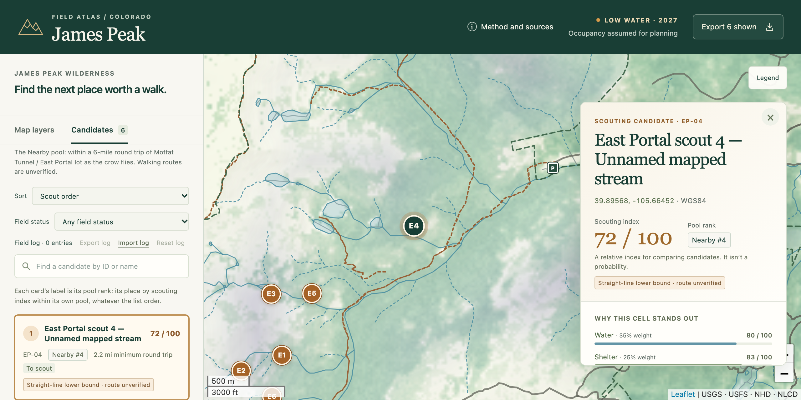

# James Peak Scouting Atlas

A map-based planning tool for picking elk scouting locations in Colorado's James Peak Wilderness. It sets 16 modelled candidates next to the terrain, canopy, water and access evidence behind them, and keeps a field log of what you find.

**Live demo:** https://robdhyman.github.io/james-peak-atlas/
**The original, for comparison:** https://robdhyman.github.io/james-peak-atlas/reference/



This repository rebuilds a working vanilla-JavaScript atlas as a Vite + React 19 + strict TypeScript + Tailwind v4 static site. The GIS data, scores and method are unchanged, byte for byte, apart from removing the owner's personal observations. The look is ported faithfully too, so the comparison is about engineering, not restyling.

The candidates come from a scenario (2027, low water, elk occupancy assumed) and a weighted index whose weights and thresholds are unvalidated planning heuristics. The scouting index is not a probability. The atlas's Method and sources dialog sets this out in full.

## Why rebuild it

The original worked, but it was one script with implicit data contracts, no tests and no build. It couldn't be published as it was:

- **Privacy.** The bundle held the owner's field observations at about 1 m precision, plus a map link and a preview image that revealed them.
- **Ambiguity.** The All list interleaved two pools' rankings, so its order wasn't a score ranking. Two darkness controls showed the same image. "Nearby" was defined three ways.
- **Silent failure.** A raster that failed to load left a checked control that looked fine. Export ignored the search and status filters without saying so. A failed save to browser storage went unreported.
- **No verification.** The GPX export had never been checked end to end. There was no CI and no lockfile.

The plan is in [`.scratch/react-rebuild/spec.md`](.scratch/react-rebuild/spec.md), worked as the tickets beside it.

## What changed, and the evidence

Each improvement is checked by a test that runs in CI. The "before" column describes the [reference copy](https://robdhyman.github.io/james-peak-atlas/reference/), which you can open beside the demo.

| | Before | After | Evidence |
|---|---|---|---|
| **Ranking** | All interleaved the Nearby and Wilderness context pools' within-pool ranks | An explicit Sort control: Scout order, Scouting index or one component. Each card shows its pool rank (for example "Nearby #2") apart from its list position | [`visibleList.test.ts`](src/candidates/visibleList.test.ts), [`candidates.spec.ts`](tests/e2e/candidates.spec.ts) |
| **Darkness** | Two toggles, "Distance from human access" and "Darkness / separation", drew the same image | One "Darkness: distance from access (0–2,000 m)" layer, with its legend in metres | [`layers.spec.ts`](tests/e2e/layers.spec.ts) |
| **Layer failure** | A raster that failed to load could leave its control checked, looking as if it worked | The control unchecks itself, gives the reason and offers Retry, which reloads that layer only | [`layers.spec.ts`](tests/e2e/layers.spec.ts) blocks real requests and recovers them |
| **Export** | Exported the whole scope, whatever the search said | "Export N shown" exports exactly the visible list, with its field log. Each format is saved as a real download and parsed back, including notes with `&`, `<`, quotes, line breaks and formula-like text | [`exportCandidates.test.ts`](src/export/exportCandidates.test.ts), [`export.spec.ts`](tests/e2e/export.spec.ts) |
| **Field log** | A failed save to browser storage went unreported | Versioned and validated. A failed save says so and stays on screen. An unreadable log is backed up, never deleted. It imports and exports as JSON | [`fieldLog.test.ts`](src/fieldLog/fieldLog.test.ts), [`fieldLog.spec.ts`](tests/e2e/fieldLog.spec.ts) |
| **Public data boundary** | Observations were in the shipped data | No observations in the repository, its history or the deployed site, and no trace in the UI of where they were. CI fails the build if any appear | [ADR 0001](docs/adr/0001-withhold-observations-from-public-build.md), [`check-public-build.mjs`](scripts/check-public-build.mjs), [`observations.spec.ts`](tests/e2e/observations.spec.ts) |
| **Shareable views** | None | The URL hash carries the selected candidate, scope and sort. A broken link falls back to the default view with a notice | [`viewLink.test.ts`](src/candidates/viewLink.test.ts), [`links.spec.ts`](tests/e2e/links.spec.ts) |
| **Accessibility** | Muted greys measured 3.3–4.4:1 contrast, and the numerals on amber markers 3.3:1 | Every candidate can be reached and inspected by keyboard alone, without the map. axe-core finds no WCAG 2.2 AA violations, with one documented exception. A drawer layout at 390 px | [`usability.spec.ts`](tests/e2e/usability.spec.ts), [`docs/usability/`](docs/usability/README.md) |

## Architecture

Six modules. The four pure ones make up the **atlas core**: no React, no DOM, no Leaflet.

| Module | Where | What it does |
|---|---|---|
| **Data** (pure) | [`src/atlas/`](src/atlas/) | Loads the manifest, layers, candidates, observations, method and canopy grid through an injected fetch. Returns a validated, read-only atlas or a typed error naming the file, the record and the problem. Types are derived from Zod 4 schemas |
| **Candidates** (pure) | [`src/candidates/`](src/candidates/) | One selector turns the atlas, scope, sort, search, field-status filter and field log into the visible list. The list, the map markers and Export all read it. The view-link codec lives here too |
| **Export** (pure) | [`src/export/`](src/export/) | Turns the visible list and the field log into GeoJSON, GPX or CSV text. Starting the download is the UI's job |
| **Field log** (pure codec + hook) | [`src/fieldLog/`](src/fieldLog/) | Decodes a stored value as valid, empty or invalid (kept for backup), and validates imports all-or-nothing. A thin hook persists through an injected `Storage` |
| **Map adapter** (imperative) | [`src/map/`](src/map/) | Owns the Leaflet map, created once per mount. React drives it through a narrow interface: layers, opacity, candidates, selection, fit. It reports clicks, canopy probes and layer errors back through callbacks ([ADR 0002](docs/adr/0002-leaflet-behind-own-adapter.md)) |
| **UI** (React) | [`src/ui/`](src/ui/), [`src/App.tsx`](src/App.tsx) | Keeps state in one of four places, by how long it needs to last: the URL hash, a reducer at the root, the field-log hook, and the read-only atlas. No state library, no router |

### Two test seams

- **The atlas core, through Vitest.** The four pure modules, through their public functions only. The fixtures are the real bundled data plus small malformed variants. Expected values are fixed by hand, never produced by a second run of the code. For example, the scout order EP-04, EP-05, EP-03, EP-01, EP-06, EP-02 is written into the test.
- **The browser, through Playwright.** The built site, served at its real Pages subpath. The map adapter and every component are tested only here: layers, presets, keyboard journeys, links, blocked requests, storage that throws, real downloads, and the public build's contents.

There's no standing component-test layer. A component test would be added only for a case Playwright can't reach cheaply, and none has been needed so far.

### Decisions and vocabulary

- [ADR 0001](docs/adr/0001-withhold-observations-from-public-build.md): withhold personal observations from the public build
- [ADR 0002](docs/adr/0002-leaflet-behind-own-adapter.md): keep Leaflet behind a hand-written adapter, not `react-leaflet` or MapLibre
- [`GLOSSARY.md`](GLOSSARY.md): Candidate, Observation, Origin, Pool, Pool rank, Scouting index, Scout order, Field log, Minimum round trip…
- [`docs/DATA_CONTRACTS.md`](docs/DATA_CONTRACTS.md) and [`docs/SOURCES.md`](docs/SOURCES.md): the data's shape and where it came from

## What the tests do and don't cover

**Covered, in CI on every pull request:**

- Every data contract from the original package's check: 16 unique candidates, six Nearby, scores consistent with the weights, `[lon, lat]` order, raster bounds, canopy NoData (255) kept apart from 0%, 40-ft contours. `public/data/` must match the reference copy byte for byte, apart from the manifest and the observations file.
- The visible list's scopes, sorts, tie-breaks, search and filters, and its use by the list, markers and Export alike.
- Each serialiser, against fixed expected output, and each format again as a real downloaded file.
- The field log through reloads, two open tabs, a storage that throws, a corrupt stored value, and imports with every kind of problem.
- Layer and fatal failures, forced by blocking real requests.
- The keyboard-only journey, axe-core scans of the main states, and the 390 px layout.
- The public build: no observations, no CalTopo link, no observation UI.

**Not covered:**

- **The model.** The GIS pipeline that produced the candidates isn't re-run, and nothing here validates its ecology. A passing build says the data is shown faithfully, not that it's right.
- **Other browsers and devices.** Playwright runs desktop Chromium only, with 390 px and touch emulated. Firefox, Safari and real phones aren't tested.
- **Screen readers.** Roles, names and live regions are checked by axe-core and by assertions, but no session with a real screen reader is recorded.
- **Rendering.** Tests check which layers are drawn and from which files, not how they look. There are no visual snapshots.
- **Performance.** Payload size, render time and memory aren't measured.
- **The private build.** Its browser tests run on the owner's machine only, and refuse to run in CI.
- **The reference copy.** It's kept as it was, checked only by its own asset and data script.

## Run, test and build

Requires Node 24 LTS (see `.nvmrc`).

```sh
npm ci
npm run dev
```

The site is served under `/james-peak-atlas/`, the GitHub Pages subpath. CI runs these steps in this order on every pull request, and on `main` it then deploys to Pages:

```sh
npm run check:data   # reference data contracts, and public/data matches the reference copy
npm run typecheck
npm test             # Vitest
npm run build        # dist/, with the reference atlas at dist/reference/
npm run check:build  # dist/ ships zero observations and no CalTopo map link
npm run test:e2e     # Playwright against the built site; run `npx playwright install chromium` once
```

To run the reference atlas on its own:

```sh
cd reference
npm start
```

Open http://127.0.0.1:4173. `npm run check` verifies its assets and data contracts.

### Layout

| Path | Purpose |
|---|---|
| `src/` | The rebuild, as the six modules above. The reference look is ported into Tailwind theme tokens in `src/index.css` |
| `public/data/` | The rebuild's data: the bundled GIS layers, candidates and method, with the origin in the manifest and an empty observations file |
| `scripts/` | The data check, the public-build check, and the step that copies the reference atlas into `dist/reference/` |
| `tests/e2e/` | Playwright tests against the built site at its Pages subpath |
| `reference/` | The original atlas, stripped of observations but otherwise unedited. See [`reference/README.md`](reference/README.md) |
| `docs/` | Data contracts, source register, ADRs, usability evidence, and the historical model scripts |

## Privacy

The owner's personal field observations aren't in this repository or its history ([ADR 0001](docs/adr/0001-withhold-observations-from-public-build.md)). The public build ships an empty observations collection, and with none the atlas shows no observation UI at all. East Portal, a public parking lot, is the origin. In the reference copy the **Your locations** control does nothing for the same reason.

The owner's own copy is a separate private build. It reads the git-ignored `private/observations.geojson` in place of the empty file, and never runs in CI:

```sh
npm run dev:private       # dev server with observations
npm run build:private     # dist-private/, never dist/
npm run test:e2e:private  # Playwright against dist-private/; refuses to run when CI is set
```

In CI, `check:build` searches `dist/` for CalTopo map links. If the optional `CALTOPO_MAP_ID` repository secret is set, it searches for the bare map ID too.

## Credits

**The original atlas was generated with ChatGPT.** That covers the vanilla-JavaScript app, the GIS model pipeline in [`docs/reference/`](docs/reference/), the assembly of the public data into the bundle, and the rebuild handoff in [`docs/REBUILD_HANDOFF.md`](docs/REBUILD_HANDOFF.md). It's the baseline, kept unedited apart from the privacy removals, in [`reference/`](reference/).

**The rebuild was implemented with Claude Code.** Every commit is co-authored by Claude. The owner made the decisions: the spec and its scope, the ADRs, the ticket order, which improvements to make and which to leave out, and the review of each slice. The workflow (grill, spec, tickets, test-first slices, review) follows [Matt Pocock's skills](https://github.com/mattpocock/skills). What this repository is meant to show is that judgement, and the verification behind it.

**Map data** comes from public agencies, under their own terms ([`docs/SOURCES.md`](docs/SOURCES.md) has the full register):

- USDA Forest Service: wilderness boundary, trails, roads and recreation sites, and NLCD tree canopy cover
- U.S. Geological Survey: 2022 US Topo quadrangles, 3D Elevation Program elevation, the National Hydrography Dataset, and PAD-US ownership
- Colorado Parks and Wildlife: game management units

**Software:** [Leaflet](https://leafletjs.com/) draws the map, as it did in the original. The rebuild is built on [React](https://react.dev/), [Zod](https://zod.dev/), [Vite](https://vite.dev/) and [Tailwind CSS](https://tailwindcss.com/), and tested with [Vitest](https://vitest.dev/), [Playwright](https://playwright.dev/) and [axe-core](https://github.com/dequelabs/axe-core).

## Licence

The application code is [MIT](LICENSE). That covers the code only. The map data keeps its providers' terms, and third-party software keeps its own licence: see [`THIRD_PARTY_NOTICES.md`](THIRD_PARTY_NOTICES.md). The deployed site carries the bundled packages' licences at [`third-party-licenses.md`](https://robdhyman.github.io/james-peak-atlas/third-party-licenses.md).
