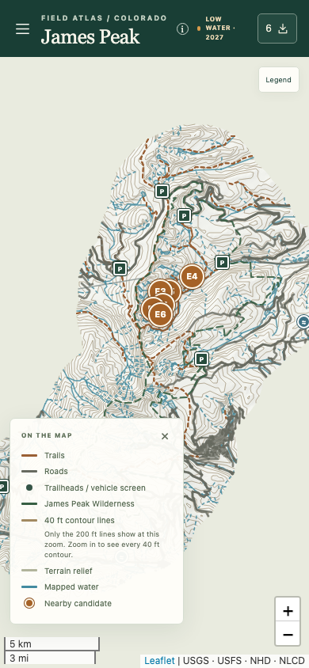
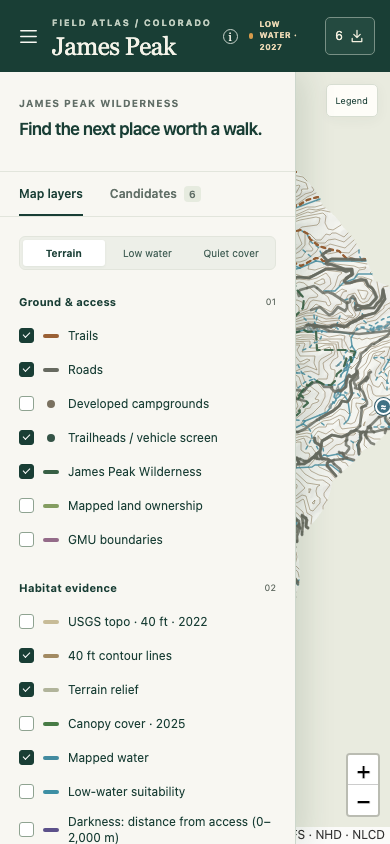
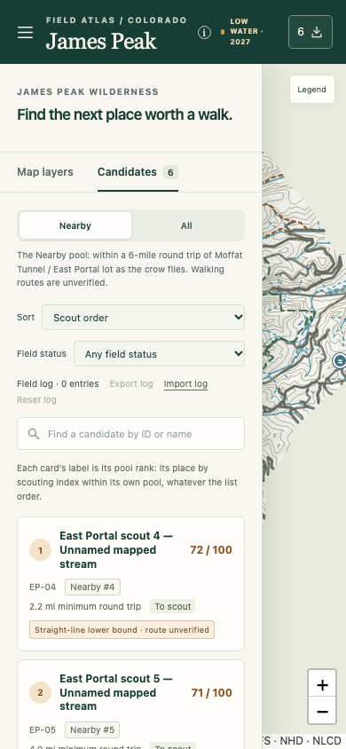
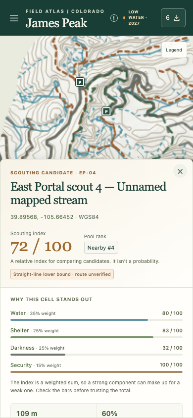

# Usability and resilience evidence

Ticket 12's checks, kept as tests in `tests/e2e/usability.spec.ts`. They run in CI with the rest of the browser tests.

## 390 px

Captured by the 390 px drawer test, on an 390 × 844 viewport.

| Map | Drawer: layers | Drawer: candidates | Detail sheet |
| --- | --- | --- | --- |
|  |  |  |  |

Below 800 px the sidebar is a drawer over the map, as in the reference atlas. It opens from the header's Map controls button and starts closed. Choosing a candidate closes it. Closing a detail that was opened from the list opens the drawer again and focuses the card. Escape closes the drawer and focuses its button. Moving focus out of the drawer closes it too, so Tab never leaves focus on a marker hidden underneath (WCAG 2.4.11).

## WCAG 2.2 AA

axe-core scans the layers panel, the list, a candidate's detail, the method dialog, the export menu, the reset dialog, the failure notices, and the drawer and detail sheet at 390 px. Every scan must come back clean, apart from the one accepted finding below.

**Accepted: map markers smaller than 24 px apart (2.5.8).** Markers sit where their places are, so nearby candidates overlap at the opening zoom, and two Rogers Pass trailheads share one spot. WCAG's Understanding document for 2.5.8 uses map pins as its example of the "essential" exception. Each candidate marker also has an equivalent target in its list card. Every point marker is a 24 px target and can be reached with Tab.

**Fixed rather than accepted:**

- **Contrast.** The reference's muted greys measured 3.3–4.4:1, and the white numerals on the amber candidate markers measured 3.3:1. Each grey has been darkened along its own hue just enough to reach 4.5:1 on the light surfaces it's used on. The marker amber is now `#a56227`, up from `#c7762f`, which gives its numerals 4.6:1.
- **Label in name (2.5.3).** A candidate marker's accessible name now ends with the short label it shows, as in "…, marker E4".
- **Target size.** Trailhead, campground and spring icons are 24 px targets around their 17 px symbols.

## Screen readers

- One status region in the map's main area is present from the first render. It announces a layer that fails after load (the Layers tab may not be showing) and a pasted link that can't be followed. The visible notices say the same thing without being live regions themselves, so nothing is read out twice. A failed layer's switch is described by its failure message.
- The import report is a status region that's always present.
- A feature popup's title, metadata and cautions are read out through a status region owned by the map adapter.
- Candidate markers come before trailhead markers in the tab order. Map panes are created top first, and their z-index sets the stacking.
